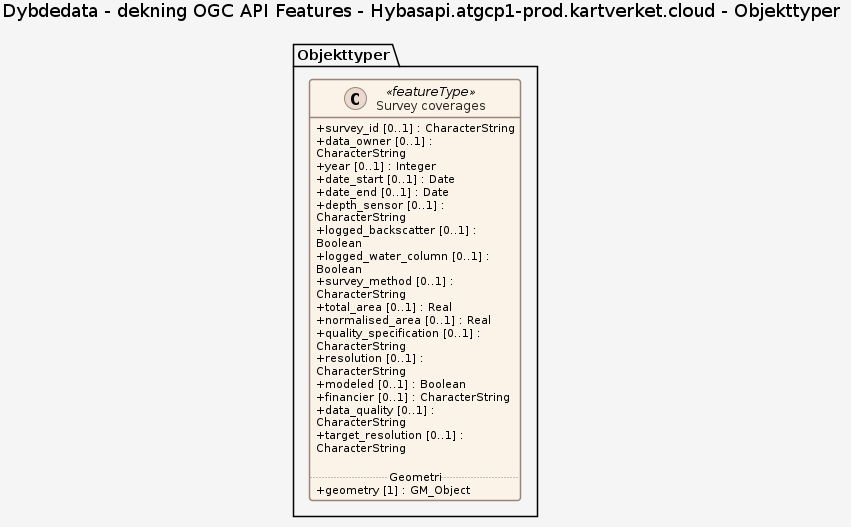

# Produktspesifikasjon: Dybdedata - dekning OGC API Features

*Tjenesten viser en oversikt over hvilke norske sjøområder som har blitt dybdekartlagt/sjømålt. Dybdedata er samlet inn over en lang tidsperiode, av ulike aktører og med ulikt utstyr. I egenskapstabellen til datasettet finnes det opplysninger som måleårstall, kartleggingsmetode, dataeier/hvilken aktør som har samlet inn dataene, utstyr, ekkolodd-type, spesifikasjon og oppløsning. 
Innholdet i tjenesten er basert på tilgjengelig data hos Kartverket.

Kvalitet på data oppgis som en egenskap i egenskapstabellen, med en kategorisering på 1-4, hvor 1 er best kvalitet og 4 er dårligst. Disse er kategorisert etter dybdesensor (i hovedsak ekkoloddtype, men andre dybdesensorer kan forekomme, eks. laser). Kategori 1 er moderne multistråle, kategori 2 er relativt gode data, men inneholder mer støy og hull en kategori 1, Kategori 3 er eldre multistråle, vanlig før år 2000, og kategori 4 er enkeltstråledata eller andre innsamlingsmetoder med lav kvalitet. 

Tjenesten har to verdier som beskriver oppløsning: resolution og target_resolution. Resolution viser hvilken oppløsning Kartverket allerede har griddet målingen til, beregnet med søkeradius-metoden. target_resolution er et automatisk beregnet estimat som viser hvor grovt datasettet maksimalt bør griddes for at kvaliteten skal være tilfredsstillende over hele måleoppdraget. Beregningen gjøres ved å analysere punkttettheten i datasettet (binning-metoden) og ta utgangspunkt i de 5 % av områdene som har lavest punkttetthet. Verdien gir dermed en konservativ og helhetlig anbefalt grid-oppløsning for hele datasettet.

Denne tjenesten er basert på OGC-API Features. OGC-API er en gruppe nye standarder som blir utviklet av Open Geospatial Consortium (OGC) for lettere å kunne tilgjengeliggjøre geografiske data på web. 
Ikke alle GIS-programvarer har etablert støtte til de nye standarder, som gjør at funksjonaliteten kan oppleves som noe tregt i enkelte klienter, som f.eks. QGIS.

Tjenesten har en egen landingsside for forhåndsvisning og filtrering av innhold: <https://hybasapi-portal.atgcp1-prod.kartverket.cloud/*>

**Nøkkelord:** MAREANO, batymetri, dybdedata, DTM, sjømåling, ekkolodd, Marine grunnkart, Høyde, Høydedata

**Emnekategorier:** 

**Geografisk område**:
Nordsjøen, Barentshavet, Havområde, Hav, Sjømåling, MAREANO, Norge, Svalbard, Dybdedata, Batymetri

**Tidsmessig utstrekning**:

- **Tidsperiode**:
  - **Fra**: 2025-02-14
  - **Til**: 2026-05-20

## Om spesifikasjonen

> **Denne versjonen av produktspesifikasjonen:**  
> **Opprettet dato:** 2025-02-14 
> **Endret dato:** 2026-05-20 
> **Språk:**  
> **Kontaktinformasjon:** Kartverket, [kundesenteret@kartverket.no](mailto:kundesenteret@kartverket.no)

## Om produktet Dybdedata - dekning OGC API Features

> **Romlig representasjonstype:**  
> **Unik identifikator:** 58a262c2-4903-4dea-9490-10065fda6756 
> **Kontaktinformasjon:** Kartverket, [kundesenteret@kartverket.no](mailto:kundesenteret@kartverket.no)
>
> **Romlig oppløsning:**
>
>
>
> **Begrensninger:**
>
> **Juridiske begrensninger**:
>
> - **Tilgangsbegrensninger**: Åpne data
> - **Bruksbegrensninger**: Lisens
> - **Lisens**: Creative Commons BY 4.0 (CC BY 4.0)
> - **Lisenslenke**: <https://creativecommons.org/licenses/by/4.0/>
>
> **Sikkerhetsbegrensninger**:
>
> - **Klassifisering**: Ugradert

### Formål

Formålet med tjenesten er å gi en oversikt over innsamlede og tilgjengelige dybdedata.

### Bruksområde

Tjenesten kan benyttes til å få en oversikt over tilgjengelige dybdedata, f.eks. i forbindelse med planlagte aktiviteter i et spesifikt område. Ved hjelp av informasjon tilgjengelig i egenskapstabellen, vil man kunne få et innblikk i kvalitet og egnethet av dybdedata. Nyere data er å anse av best kvalitet, da det har hovedsakelig blitt samlet inn ved bruk av multistråle ekkolodd, mens eldre data er samlet inn med enkeltstråle ekkolodd eller annet eldre utstyr.  
Tjenesten kan også benyttes til kart, presentasjoner, ulike analyser eller som beslutningsgrunnlag.

## Omfang

### Hele datasettet

**Nivå**: dataset

**Nivåbeskrivelse**: Gjelder hele datasettet. Hvis omfang ikke er oppgitt under en overskrift, gjelder teksten for hele datasettet og alle leveranser

### Hybasapi.atgcp1-prod.kartverket.cloud

**Nivå**: dataset

**Nivåbeskrivelse**: OGC API-Features fra Kartverket

## Datainnhold og struktur

### Datamodell - Hybasapi.atgcp1-prod.kartverket.cloud

➡️ [Se full datamodell for omfang "Hybasapi.atgcp1-prod.kartverket.cloud" (diagram per pakke og objektkatalog)](hybasapi-atgcp1-prod-kartverket-cloud/objektkatalog.html)

## Datakvalitet

**Nivå**: service

## Datafangst og produksjon

Tjenesten tar utgangspunkt i Kartverkets oversikt over dekning sjømålte områder. Datasettet er delt inn i polygoner, hvor hvert polygon representerer et måleoppdrag (et oppdrag, tokt eller datasett med dybdedata) og viser utstrekningen av sjømålt område. Måleoppdragene er identifisert med en unik og persistent ID, som benyttes som identifikator for det bestemte måleoppdraget/toktet.

## Vedlikehold

**Vedlikeholdsfrekvens**: Kontinuerlig

**Status**: Kontinuerlig oppdatert

## Leveranse

| Tjeneste | Endepunkt | Type | Format | Leveranseenheter |
| --- | --- | --- | --- | --- |
| OGC API-Features | [Lenke](https://hybasapi.atgcp1-prod.kartverket.cloud/) | OGC:API-Features | GeoJSON | landsfiler |

## Metadata

**Metadatastandard**: ISO19115

**Metadatastandardversjon**: 2003

**Metadatadato**: 2026-07-02

**språk**: nor

**Kontakt**:

- **Organisasjon**: Kartverket
- **Kontaktperson**: Matilde Skjæveland Skår
- **Logo**: <https://register.geonorge.no/data/organizations/971040238_Kartverket_liten.png>
- **Epost**: kundesenteret@kartverket.no
- **rolle**: pointOfContact

**Metadataidentifikator**:

- **Utsteder**: Geonorge
- **kode**: 58a262c2-4903-4dea-9490-10065fda6756
- **koderom**: <https://kartkatalog.geonorge.no/metadata/>
- **Metadatalenke**: <https://kartkatalog.geonorge.no/metadata/58a262c2-4903-4dea-9490-10065fda6756>

