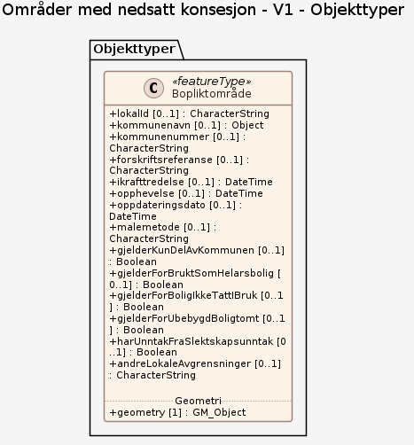

### Datamodell

**Kilde:** [OGC API - Features](https://inndelinger.api.kartverket.no/v1)

#### Bopliktområde

Bopliktområder

Geometri: Elementtype: feature Type: geometry-any Lagrings-CRS: • <a href="http://www.opengis.net/def/crs/EPSG/0/25833"><http://www.opengis.net/def/crs/EPSG/0/25833></a> Koordinatreferansesystem (crs): • <a href="http://www.opengis.net/def/crs/EPSG/0/25833"><http://www.opengis.net/def/crs/EPSG/0/25833></a> • <a href="http://www.opengis.net/def/crs/OGC/1.3/CRS84"><http://www.opengis.net/def/crs/OGC/1.3/CRS84></a>

Egenskaper

<table class="feature-attribute-table">
  <thead>
    <tr>
      <th>Egenskap</th>
      <th>Beskrivelse</th>
      <th>Type</th>
      <th>Multiplisitet</th>
    </tr>
  </thead>
  <tbody>
    <tr>
      <td>geometry</td>
      <td>Elementtype: feature OGC-rolle: primary-geometry</td>
      <td>geometry-any</td>
      <td></td>
    </tr>
    <tr>
      <td>lokal<wbr />Id</td>
      <td>lokalId OGC-rolle: id</td>
      <td>string</td>
      <td>0..1</td>
    </tr>
    <tr>
      <td>kommunenavn</td>
      <td>kommunenavn</td>
      <td>object</td>
      <td>0..1</td>
    </tr>
    <tr>
      <td>kommunenummer</td>
      <td>kommunenummer</td>
      <td>string</td>
      <td>0..1</td>
    </tr>
    <tr>
      <td>forskriftsreferanse</td>
      <td>forskriftsreferanse</td>
      <td>string</td>
      <td>0..1</td>
    </tr>
    <tr>
      <td>ikrafttredelse</td>
      <td>ikrafttredelse</td>
      <td>date-time (string)</td>
      <td>0..1</td>
    </tr>
    <tr>
      <td>opphevelse</td>
      <td>opphevelse</td>
      <td>date-time (string)</td>
      <td>0..1</td>
    </tr>
    <tr>
      <td>oppdateringsdato</td>
      <td>oppdateringsdato</td>
      <td>date-time (string)</td>
      <td>0..1</td>
    </tr>
    <tr>
      <td>malemetode</td>
      <td>malemetode</td>
      <td>string</td>
      <td>0..1</td>
    </tr>
    <tr>
      <td>gjelder<wbr />Kun<wbr />Del<wbr />Av<wbr />Kommunen</td>
      <td>gjelderKunDelAvKommunen</td>
      <td>boolean</td>
      <td>0..1</td>
    </tr>
    <tr>
      <td>gjelder<wbr />For<wbr />Brukt<wbr />Som<wbr />Helarsbolig</td>
      <td>gjelderForBruktSomHelarsbolig</td>
      <td>boolean</td>
      <td>0..1</td>
    </tr>
    <tr>
      <td>gjelder<wbr />For<wbr />Bolig<wbr />Ikke<wbr />Tatt<wbr />IBruk</td>
      <td>gjelderForBoligIkkeTattIBruk</td>
      <td>boolean</td>
      <td>0..1</td>
    </tr>
    <tr>
      <td>gjelder<wbr />For<wbr />Ubebygd<wbr />Boligtomt</td>
      <td>gjelderForUbebygdBoligtomt</td>
      <td>boolean</td>
      <td>0..1</td>
    </tr>
    <tr>
      <td>har<wbr />Unntak<wbr />Fra<wbr />Slektskapsunntak</td>
      <td>harUnntakFraSlektskapsunntak</td>
      <td>boolean</td>
      <td>0..1</td>
    </tr>
    <tr>
      <td>andre<wbr />Lokale<wbr />Avgrensninger</td>
      <td>andreLokaleAvgrensninger</td>
      <td>string</td>
      <td>0..1</td>
    </tr>
  </tbody>
</table>
