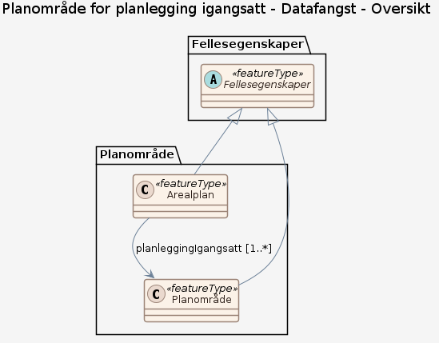
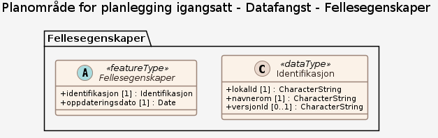
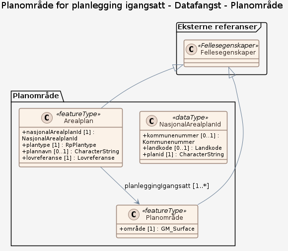
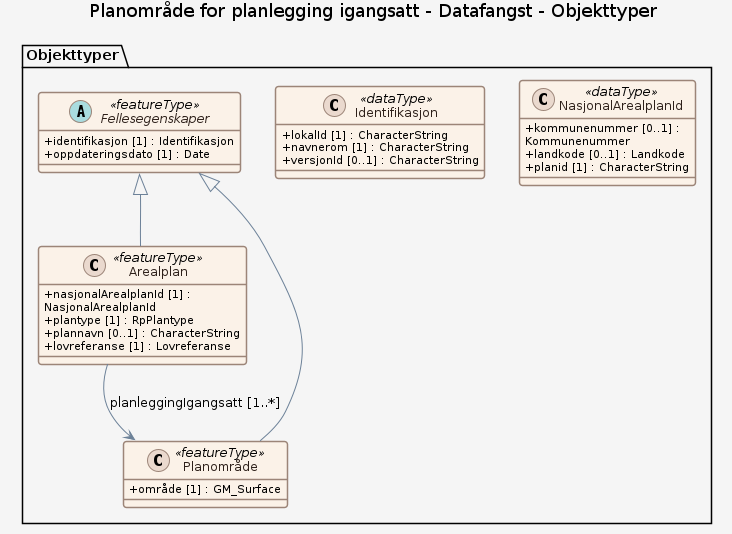

### Datamodell

**Kilde:** [SOSI UML XMI-fil](https://sosi.geonorge.no/svn/SOSI/SOSI Del 3/Kommunal- og moderniseringsdepartementet/Arealplan/Arealplan 5.0/PlanleggingIgangsatt.xml)

#### Oversikt

#### Pakke: Fellesegenskaper

#### Pakke: Planområde

#### Komplett diagram

#### Fellesegenskaper (abstrakt)

abstrakt objekttype som bærer de egenskapene fra SOSI_Fellesegenskaper som er anvendt på objekttypene i denne modellen.

Egenskaper

<table class="feature-attribute-table">
  <thead>
    <tr>
      <th>Egenskap</th>
      <th>Beskrivelse</th>
      <th>Type</th>
      <th>Multiplisitet</th>
    </tr>
  </thead>
  <tbody>
    <tr>
      <td>identifikasjon</td>
      <td>unik identifikasjon av et dataobjekt  Følger dataobjektet og identifiserer det i hele dets levetid.</td>
      <td>Identifikasjon (datatype)</td>
      <td>1</td>
    </tr>
    <tr>
      <td>- lokal<wbr />Id</td>
      <td>lokal identifikator av et objekt.  Skal være en uuid, slik at den er unik, uavhengig av navnerommet</td>
      <td>Character<wbr />String</td>
      <td>1</td>
    </tr>
    <tr>
      <td>- navnerom</td>
      <td>navnerom som unikt identifiserer datakilden til et objekt.  Navnerom anbefales å være en http-URI og må være registrert i data.geonorge.no For plan anbefales navnerommet <a href="http://data.geonorge.no/sosi/plan">http://data.geonorge.no/sosi/plan</a></td>
      <td>Character<wbr />String</td>
      <td>1</td>
    </tr>
    <tr>
      <td>- versjon<wbr />Id</td>
      <td>identifikasjon av en spesiell versjon av et geografisk objekt (instans)</td>
      <td>Character<wbr />String</td>
      <td>0..1</td>
    </tr>
    <tr>
      <td>oppdateringsdato</td>
      <td>tidspunkt for siste endring på dataobjektet</td>
      <td>Date<wbr />Time</td>
      <td>1</td>
    </tr>
  </tbody>
</table>

#### Arealplan

dataobjekt for igangsatt planlegging etter pbl

Egenskaper

<table class="feature-attribute-table">
  <thead>
    <tr>
      <th>Egenskap</th>
      <th>Beskrivelse</th>
      <th>Type</th>
      <th>Multiplisitet</th>
    </tr>
  </thead>
  <tbody>
    <tr>
      <td>nasjonal<wbr />Arealplan<wbr />Id</td>
      <td>landsdekkende entydig og unik identifikasjon av en arealplan (pbl. §§ 6-4, 9-1, og 12-1, samt kart- og planforskriften § 9 andre og sjette ledd).  Denne identifikatoren tildeles planen når planprosessen starter, og den kan ikke endres undervegs av forslagstiller.</td>
      <td>Nasjonal<wbr />Arealplan<wbr />Id (datatype)</td>
      <td>1</td>
    </tr>
    <tr>
      <td>- kommunenummer</td>
      <td>kode som viser til offisiell nummerering av kommuner  Merknad: Det presiseres at kommunenummer alltid skal ha 4 siffer, dvs. eventuelt med ledende null. Kommunenummer benyttes for kobling mot en rekke andre registre som også benytter 4 siffer.</td>
      <td><a href="#kodeliste-kommunenummer">Kommunenummer</a> (kodeliste)</td>
      <td>0..1</td>
    </tr>
    <tr>
      <td>- landkode</td>
      <td>landkode = NO anvendes kun av statlig vedtaksmyndighet</td>
      <td><a href="#kodeliste-landkode">Landkode</a> (enumerering)</td>
      <td>0..1</td>
    </tr>
    <tr>
      <td>- planid</td>
      <td>entydig identifikasjon av en plan innen vedkommende administrative enhet (pbl. §§ 9-1, 12-1, samt kart- og planforskriften § 9 andre og sjette ledd)</td>
      <td>Character<wbr />String</td>
      <td>1</td>
    </tr>
    <tr>
      <td>plantype</td>
      <td>type reguleringsplan (pbl. §§ 12-2 og 12-3)</td>
      <td><a href="#kodeliste-rpplantype">Rp<wbr />Plantype</a> (kodeliste)</td>
      <td>1</td>
    </tr>
    <tr>
      <td>plannavn</td>
      <td>planens offisielle navn</td>
      <td>Character<wbr />String</td>
      <td>0..1</td>
    </tr>
    <tr>
      <td>lovreferanse</td>
      <td>kode for hvilken lov planen vedtas etter  For reguleringsplanforslag og planlegging igangsatt skal lovreferanse = 6 (pbl 2008)</td>
      <td><a href="#kodeliste-lovreferanse">Lovreferanse</a> (kodeliste)</td>
      <td>1</td>
    </tr>
    <tr class="inherited-from">
      <th colspan="4" scope="rowgroup">Arvet fra Fellesegenskaper</th>
    </tr>
    <tr>
      <td>identifikasjon</td>
      <td>unik identifikasjon av et dataobjekt  Følger dataobjektet og identifiserer det i hele dets levetid.</td>
      <td>Identifikasjon (datatype)</td>
      <td>1</td>
    </tr>
    <tr>
      <td>- lokal<wbr />Id</td>
      <td>lokal identifikator av et objekt.  Skal være en uuid, slik at den er unik, uavhengig av navnerommet</td>
      <td>Character<wbr />String</td>
      <td>1</td>
    </tr>
    <tr>
      <td>- navnerom</td>
      <td>navnerom som unikt identifiserer datakilden til et objekt.  Navnerom anbefales å være en http-URI og må være registrert i data.geonorge.no For plan anbefales navnerommet <a href="http://data.geonorge.no/sosi/plan">http://data.geonorge.no/sosi/plan</a></td>
      <td>Character<wbr />String</td>
      <td>1</td>
    </tr>
    <tr>
      <td>- versjon<wbr />Id</td>
      <td>identifikasjon av en spesiell versjon av et geografisk objekt (instans)</td>
      <td>Character<wbr />String</td>
      <td>0..1</td>
    </tr>
    <tr>
      <td>oppdateringsdato</td>
      <td>tidspunkt for siste endring på dataobjektet</td>
      <td>Date<wbr />Time</td>
      <td>1</td>
    </tr>
  </tbody>
</table>

Relasjoner

**Arv**
Fellesegenskaper

**Assosiasjoner**
Planområde – rolle: planleggingIgangsatt – kardinalitet: 1..*

#### Planområde

område for planlegging igangsatt etter pbl 2008.  Området skal være sammenhengende i grunnriss, men kan dekke flere vertikalnivåer

Egenskaper

<table class="feature-attribute-table">
  <thead>
    <tr>
      <th>Egenskap</th>
      <th>Beskrivelse</th>
      <th>Type</th>
      <th>Multiplisitet</th>
    </tr>
  </thead>
  <tbody>
    <tr>
      <td>område</td>
      <td>planens utstrekning i grunnriss uavhengig av vertikalnivå</td>
      <td>GM_<wbr />Surface</td>
      <td>1</td>
    </tr>
    <tr class="inherited-from">
      <th colspan="4" scope="rowgroup">Arvet fra Fellesegenskaper</th>
    </tr>
    <tr>
      <td>identifikasjon</td>
      <td>unik identifikasjon av et dataobjekt  Følger dataobjektet og identifiserer det i hele dets levetid.</td>
      <td>Identifikasjon (datatype)</td>
      <td>1</td>
    </tr>
    <tr>
      <td>- lokal<wbr />Id</td>
      <td>lokal identifikator av et objekt.  Skal være en uuid, slik at den er unik, uavhengig av navnerommet</td>
      <td>Character<wbr />String</td>
      <td>1</td>
    </tr>
    <tr>
      <td>- navnerom</td>
      <td>navnerom som unikt identifiserer datakilden til et objekt.  Navnerom anbefales å være en http-URI og må være registrert i data.geonorge.no For plan anbefales navnerommet <a href="http://data.geonorge.no/sosi/plan">http://data.geonorge.no/sosi/plan</a></td>
      <td>Character<wbr />String</td>
      <td>1</td>
    </tr>
    <tr>
      <td>- versjon<wbr />Id</td>
      <td>identifikasjon av en spesiell versjon av et geografisk objekt (instans)</td>
      <td>Character<wbr />String</td>
      <td>0..1</td>
    </tr>
    <tr>
      <td>oppdateringsdato</td>
      <td>tidspunkt for siste endring på dataobjektet</td>
      <td>Date<wbr />Time</td>
      <td>1</td>
    </tr>
  </tbody>
</table>

Relasjoner

**Arv**
Fellesegenskaper

### Kodelister

#### «CodeList» Kommunenummer

**Definisjon:** ekstern kodeliste for kommunenummer
Koder med status Gyldig refererer til dagens kommuner, mens koder med status Utgått referer til utgåtte kommunenummer

Profilparametre i tagged values

<table class="feature-attribute-table">
  <colgroup>
    <col style="width: 35%;" />
    <col style="width: 65%;" />
  </colgroup>
  <tbody>
    <tr>
      <th scope="row">asDictionary</th>
      <td>true</td>
    </tr>
    <tr>
      <th scope="row">codeList</th>
      <td><a href="https://register.geonorge.no/sosi-kodelister/inndelinger/inndelingsbase/kommunenummer">https://register.geonorge.no/sosi-kodelister/inndelinger/inndelingsbase/kommunenummer</a></td>
    </tr>
  </tbody>
</table>

#### «Enumeration» Landkode

**Definisjon:** alfanumerisk kode for nasjonalt nivå / Norge.

Avledet fra "ISO 3166 Codes for the representation of names of countries and their subdivisions"

Koder

<table class="code-list-table">
  <thead>
    <tr>
      <th>Kodenavn:</th>
      <th>Definisjon:</th>
      <th>Kodeverdi:</th>
    </tr>
  </thead>
  <tbody>
    <tr>
      <td>NO</td>
      <td>Norge. Aktuell kode for administrativ enhet for statlig vedtatte planer</td>
      <td></td>
    </tr>
  </tbody>
</table>

#### «CodeList» RpPlantype

**Definisjon:** ekstern kodeliste for type reguleringsplan (pbl. §§ 12-2 og 12-3) ihht til gjeldende lov. Angir om planen er en områdeplan eller detaljplan.

Profilparametre i tagged values

<table class="feature-attribute-table">
  <colgroup>
    <col style="width: 35%;" />
    <col style="width: 65%;" />
  </colgroup>
  <tbody>
    <tr>
      <th scope="row">asDictionary</th>
      <td>true</td>
    </tr>
    <tr>
      <th scope="row">codeList</th>
      <td><a href="https://register.geonorge.no/sosi-kodelister/plan/reguleringsplanforslag/rpplantype">https://register.geonorge.no/sosi-kodelister/plan/reguleringsplanforslag/rpplantype</a></td>
    </tr>
  </tbody>
</table>

#### «CodeList» Lovreferanse

**Definisjon:** ekstern kodeliste for gjeldende pbl.

Profilparametre i tagged values

<table class="feature-attribute-table">
  <colgroup>
    <col style="width: 35%;" />
    <col style="width: 65%;" />
  </colgroup>
  <tbody>
    <tr>
      <th scope="row">asDictionary</th>
      <td>true</td>
    </tr>
    <tr>
      <th scope="row">codeList</th>
      <td><a href="https://register.geonorge.no/sosi-kodelister/plan/reguleringsplanforslag/lovreferanse">https://register.geonorge.no/sosi-kodelister/plan/reguleringsplanforslag/lovreferanse</a></td>
    </tr>
  </tbody>
</table>
